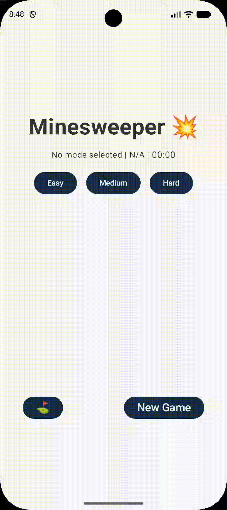
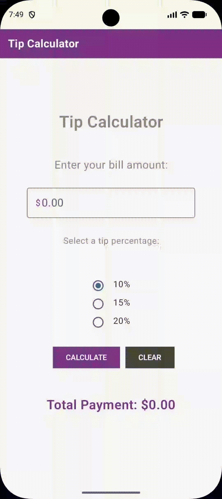
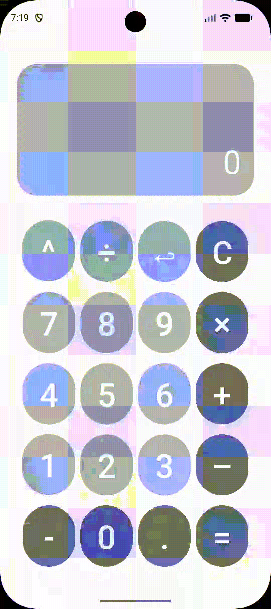

# mini-android-projs
my tiny apps from mobile software development course

## Minesweeper App @ 10/13/26
This minesweeper app supports the basic functionality of a classical minesweeper game, where you click on fields to reveal hints where potential bombs are located and flag fields where you think the bombs are placed. Additionally, this app allows for replay and offers three modes of difficulty. 

  

## Tip Calculator App @ 09/30/26
Tip calculator that accepts manual bill amount input and returns the total amount based on a selected tip percentage (10%, 15%, or 20%).

  

## Calculator App @ 09/17/26
Simple themed calculator app supporting basic operators such as +, −, ×, ÷, and ^. Users can input calculations using the keypad and receive the corresponding result.

  

